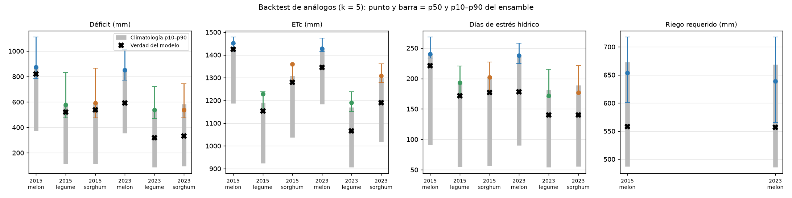

# Backtest del método de análogos

Generado con `python -m scripts.backtest`, kernel `fao56-kernel-0.1.0`. Es una validación del **método de análogos contra el propio modelo**, no de precisión de campo: la "verdad" es el kernel corrido con el clima real del año objetivo, no una medición.

> **Preliminar:** la ET0 usada tiene `reviewed: false`. Repetir cuando Justin la revise y cuando Ant entregue suelo y calendarios.

Método:

- Features con la ventana del pipeline de Abe (01-abr a 31-oct, ONI ASO, calor ≥35 °C) y pesos iguales.
- `find_analogs` solo admite candidatos **anteriores** al año objetivo. Para 2015 el conjunto es 1984–2014; es más estricto que dejar un año fuera.
- Kernel: temporada mayo–abril, suelo loam FAO-56, secano (D1), arroz 15-may, caupí y sorgo 15-oct. Riego requerido con `simulate_rotation_detailed` (corrida managed).
- Cuantiles empíricos entre años (`robustness.summarize`), no intervalos de confianza. Con k = 3 o 5, p10 y p90 quedan casi en el mínimo y el máximo del ensamble.
- Referencia: climatología, el mismo cálculo con todos los años candidatos.

## Años análogos

| Objetivo | k | Análogos (distancia) | Candidatos |
|---|---|---|---|
| 2015 | 3 | 1997 (0,24), 1987 (0,63), 1994 (1,00) | 1984–2014 (31) |
| 2015 | 5 | 1997 (0,24), 1987 (0,63), 1994 (1,00), 1990 (1,06), 1991 (1,18) | 1984–2014 (31) |
| 2023 | 3 | 2015 (0,52), 1997 (0,70), 1987 (0,75) | 1984–2022 (39) |
| 2023 | 5 | 2015 (0,52), 1997 (0,70), 1987 (0,75), 1990 (0,77), 1991 (0,92) | 1984–2022 (39) |

## Resumen

Casos = combinaciones rotación × métrica con valor (el riego solo cuenta en `rice_melon`).

| Objetivo | k | Casos | Verdad en p10–p90 (análogos) | Verdad en p10–p90 (climatología) | Análogos más cerca que la climatología (p50) |
|---|---|---|---|---|---|
| 2015 | 3 | 13 | 3 | 10 | 6 |
| 2015 | 5 | 13 | 9 | 10 | 12 |
| 2023 | 3 | 13 | 0 | 13 | 0 |
| 2023 | 5 | 13 | 3 | 13 | 3 |

## Detalle, k = 3

| Objetivo | Rotación | Métrica | Verdad | p10 | p50 | p90 | ¿Dentro? | Error p50 | p50 climatología | Error climatología |
|---|---|---|---|---|---|---|---|---|---|---|
| 2015 | `rice_melon` | Déficit (mm) | 820,2 | 900,5 | 1101,5 | 1112,3 | no | 281,3 | 578,9 | 241,3 |
| 2015 | `rice_melon` | ETc (mm) | 1425,2 | 1454,4 | 1463,0 | 1483,4 | no | 37,8 | 1318,5 | 106,7 |
| 2015 | `rice_melon` | Días de estrés hídrico | 221,0 | 245,0 | 265,0 | 269,0 | no | 44,0 | 182,0 | 39,0 |
| 2015 | `rice_melon` | Riego requerido (mm) | 558,3 | 590,9 | 653,6 | 708,2 | no | 95,2 | 572,6 | 14,3 |
| 2015 | `rice_melon` | Días de estrés térmico | 8,0 | 3,6 | 6,0 | 11,6 | sí | 2,0 | 0,0 | 8,0 |
| 2015 | `rice_legume` | Déficit (mm) | 521,5 | 625,3 | 812,9 | 836,9 | no | 291,4 | 302,7 | 218,8 |
| 2015 | `rice_legume` | ETc (mm) | 1153,8 | 1229,8 | 1236,2 | 1239,1 | no | 82,3 | 1058,4 | 95,4 |
| 2015 | `rice_legume` | Días de estrés hídrico | 172,0 | 195,6 | 206,0 | 225,2 | no | 34,0 | 139,0 | 33,0 |
| 2015 | `rice_legume` | Días de estrés térmico | 8,0 | 3,6 | 6,0 | 11,6 | sí | 2,0 | 0,0 | 8,0 |
| 2015 | `rice_sorghum` | Déficit (mm) | 538,0 | 642,2 | 843,3 | 874,2 | no | 305,3 | 327,3 | 210,7 |
| 2015 | `rice_sorghum` | ETc (mm) | 1280,2 | 1359,4 | 1359,9 | 1361,8 | no | 79,8 | 1184,7 | 95,4 |
| 2015 | `rice_sorghum` | Días de estrés hídrico | 177,0 | 205,0 | 217,0 | 230,6 | no | 40,0 | 143,0 | 34,0 |
| 2015 | `rice_sorghum` | Días de estrés térmico | 8,0 | 3,6 | 6,0 | 11,6 | sí | 2,0 | 0,0 | 8,0 |
| 2023 | `rice_melon` | Déficit (mm) | 592,7 | 826,2 | 850,3 | 1051,3 | no | 257,6 | 562,6 | 30,1 |
| 2023 | `rice_melon` | ETc (mm) | 1344,7 | 1430,6 | 1452,2 | 1481,2 | no | 107,5 | 1315,1 | 29,6 |
| 2023 | `rice_melon` | Días de estrés hídrico | 178,0 | 224,8 | 240,0 | 264,0 | no | 62,0 | 179,0 | 1,0 |
| 2023 | `rice_melon` | Riego requerido (mm) | 556,5 | 561,7 | 575,2 | 692,5 | no | 18,6 | 568,9 | 12,3 |
| 2023 | `rice_melon` | Días de estrés térmico | 2,0 | 4,0 | 8,0 | 12,0 | no | 6,0 | 0,0 | 2,0 |
| 2023 | `rice_legume` | Déficit (mm) | 319,0 | 532,9 | 578,4 | 766,0 | no | 259,3 | 281,7 | 37,4 |
| 2023 | `rice_legume` | ETc (mm) | 1066,7 | 1170,3 | 1236,2 | 1239,1 | no | 169,5 | 1047,2 | 19,5 |
| 2023 | `rice_legume` | Días de estrés hídrico | 140,0 | 176,2 | 193,0 | 222,6 | no | 53,0 | 132,0 | 8,0 |
| 2023 | `rice_legume` | Días de estrés térmico | 2,0 | 4,0 | 8,0 | 12,0 | no | 6,0 | 0,0 | 2,0 |
| 2023 | `rice_sorghum` | Déficit (mm) | 333,0 | 548,8 | 592,0 | 793,0 | no | 259,0 | 293,9 | 39,0 |
| 2023 | `rice_sorghum` | ETc (mm) | 1190,2 | 1296,0 | 1359,3 | 1361,7 | no | 169,1 | 1173,1 | 17,1 |
| 2023 | `rice_sorghum` | Días de estrés hídrico | 140,0 | 182,0 | 202,0 | 227,6 | no | 62,0 | 137,0 | 3,0 |
| 2023 | `rice_sorghum` | Días de estrés térmico | 2,0 | 4,0 | 8,0 | 12,0 | no | 6,0 | 0,0 | 2,0 |

## Detalle, k = 5

| Objetivo | Rotación | Métrica | Verdad | p10 | p50 | p90 | ¿Dentro? | Error p50 | p50 climatología | Error climatología |
|---|---|---|---|---|---|---|---|---|---|---|
| 2015 | `rice_melon` | Déficit (mm) | 820,2 | 784,3 | 875,2 | 1109,6 | sí | 55,0 | 578,9 | 241,3 |
| 2015 | `rice_melon` | ETc (mm) | 1425,2 | 1416,3 | 1452,2 | 1478,3 | sí | 27,0 | 1318,5 | 106,7 |
| 2015 | `rice_melon` | Días de estrés hídrico | 221,0 | 233,8 | 240,0 | 268,0 | no | 19,0 | 182,0 | 39,0 |
| 2015 | `rice_melon` | Riego requerido (mm) | 558,3 | 600,6 | 653,6 | 717,3 | no | 95,2 | 572,6 | 14,3 |
| 2015 | `rice_melon` | Días de estrés térmico | 8,0 | 1,0 | 3,0 | 10,2 | sí | 5,0 | 0,0 | 8,0 |
| 2015 | `rice_legume` | Déficit (mm) | 521,5 | 476,2 | 578,4 | 830,9 | sí | 56,9 | 302,7 | 218,8 |
| 2015 | `rice_legume` | ETc (mm) | 1153,8 | 1166,4 | 1228,3 | 1238,4 | no | 74,4 | 1058,4 | 95,4 |
| 2015 | `rice_legume` | Días de estrés hídrico | 172,0 | 171,4 | 193,0 | 220,4 | sí | 21,0 | 139,0 | 33,0 |
| 2015 | `rice_legume` | Días de estrés térmico | 8,0 | 1,0 | 3,0 | 10,2 | sí | 5,0 | 0,0 | 8,0 |
| 2015 | `rice_sorghum` | Déficit (mm) | 538,0 | 475,3 | 592,0 | 866,5 | sí | 54,0 | 327,3 | 210,7 |
| 2015 | `rice_sorghum` | ETc (mm) | 1280,2 | 1289,7 | 1359,3 | 1361,4 | no | 79,1 | 1184,7 | 95,4 |
| 2015 | `rice_sorghum` | Días de estrés hídrico | 177,0 | 174,4 | 202,0 | 227,2 | sí | 25,0 | 143,0 | 34,0 |
| 2015 | `rice_sorghum` | Días de estrés térmico | 8,0 | 1,0 | 3,0 | 10,2 | sí | 5,0 | 0,0 | 8,0 |
| 2023 | `rice_melon` | Déficit (mm) | 592,7 | 772,3 | 850,3 | 1011,0 | no | 257,6 | 562,6 | 30,1 |
| 2023 | `rice_melon` | ETc (mm) | 1344,7 | 1415,1 | 1428,4 | 1474,0 | no | 83,7 | 1315,1 | 29,6 |
| 2023 | `rice_melon` | Días de estrés hídrico | 178,0 | 225,0 | 238,0 | 258,0 | no | 60,0 | 179,0 | 1,0 |
| 2023 | `rice_melon` | Riego requerido (mm) | 556,5 | 565,1 | 638,7 | 717,3 | no | 82,2 | 568,9 | 12,3 |
| 2023 | `rice_melon` | Días de estrés térmico | 2,0 | 1,0 | 3,0 | 11,0 | sí | 1,0 | 0,0 | 2,0 |
| 2023 | `rice_legume` | Déficit (mm) | 319,0 | 469,4 | 538,5 | 719,1 | no | 219,4 | 281,7 | 37,4 |
| 2023 | `rice_legume` | ETc (mm) | 1066,7 | 1151,6 | 1190,9 | 1238,4 | no | 124,2 | 1047,2 | 19,5 |
| 2023 | `rice_legume` | Días de estrés hídrico | 140,0 | 171,4 | 172,0 | 215,2 | no | 32,0 | 132,0 | 8,0 |
| 2023 | `rice_legume` | Días de estrés térmico | 2,0 | 1,0 | 3,0 | 11,0 | sí | 1,0 | 0,0 | 2,0 |
| 2023 | `rice_sorghum` | Déficit (mm) | 333,0 | 475,3 | 538,0 | 742,8 | no | 205,1 | 293,9 | 39,0 |
| 2023 | `rice_sorghum` | ETc (mm) | 1190,2 | 1278,3 | 1308,7 | 1361,1 | no | 118,5 | 1173,1 | 17,1 |
| 2023 | `rice_sorghum` | Días de estrés hídrico | 140,0 | 174,4 | 177,0 | 221,2 | no | 37,0 | 137,0 | 3,0 |
| 2023 | `rice_sorghum` | Días de estrés térmico | 2,0 | 1,0 | 3,0 | 11,0 | sí | 1,0 | 0,0 | 2,0 |

El estrés térmico se cuenta solo en la etapa `mid` del arroz, así que es igual en las tres rotaciones.

