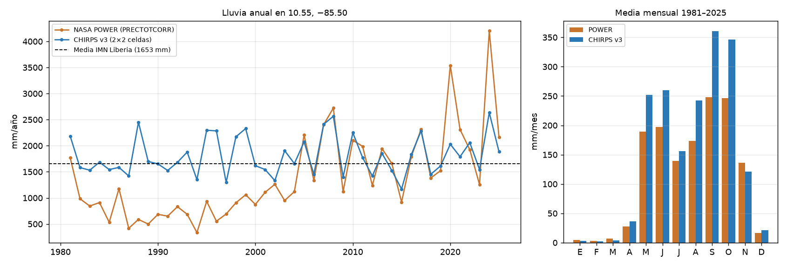

# Lluvia: POWER frente a CHIRPS v3 e IMN (tarea 4.8)

Contraste de la lluvia que usa el kernel (NASA POWER, `PRECTOTCORR`) con CHIRPS v3 y con la media anual IMN de la estación Liberia (1.652,7 mm/año). **No se corrige ninguna serie**; esta nota solo documenta la diferencia.

Reproducir:

```powershell
python -m scripts.ingest_chirps --start 1981-01 --end 2026-10
python -m scripts.rain_bias --output-dir docs
```

- `ingest_chirps` lee por rango HTTP los GeoTIFF mensuales de CHIRPS v3 para Latinoamérica (sin login). En total son unos 10 MB para 550 meses, en vez de unos 2 GB de mapas completos.
- El punto 10.55, −85.50 cae en la esquina de cuatro celdas de 0,05°, así que el valor es la media de esas 2×2 celdas.
- Salida: `datasets/processed/climate/chirps_v3_monthly_10.55_-85.5.json`.
- La tabla anual queda en [rain_bias/rain_bias.csv](rain_bias/rain_bias.csv).



## Resultados (años completos 1981–2025, n = 45)

| Serie | Media anual (mm) | Frente a IMN Liberia |
|---|---|---|
| POWER | 1.387 | −16 % |
| CHIRPS v3 | 1.805 | +9 % |
| IMN Liberia (media publicada) | 1.653 | — |

| Periodo | POWER (mm) | CHIRPS (mm) | POWER / CHIRPS |
|---|---|---|---|
| 1981–2004 | 849 | 1.758 | 0,48 |
| 2005–2025 | 2.002 | 1.858 | 1,08 |
| 1991–2020 | 1.405 | 1.799 | 0,78 |

- **POWER tiene un quiebre alrededor de 2004–2005.**
  - Antes de 2005, POWER da en promedio la mitad de la lluvia que CHIRPS. En algunos años da menos de un tercio: 1987, 1988, 1989, 1994 y 1996.
  - Desde 2005, las dos series se parecen (razón 1,08, correlación 0,83).
  - Hay años en que POWER es mucho más alto: 2020 da 3.539 mm contra 2.029, y 2024 da 4.202 mm contra 2.635.
  - CHIRPS no muestra un salto así, así que el cambio parece venir de POWER y no del clima. La correlación anual de toda la serie es solo 0,53.
- **Estacionalidad:** las dos series ubican igual la época seca (diciembre–abril) y los dos picos de lluvia (mayo–junio y septiembre–octubre). La diferencia está en el tamaño de los picos: entre mayo y octubre, POWER queda 25–30 % por debajo de CHIRPS en promedio.
- **Frente a IMN:** CHIRPS queda más cerca de la media de Liberia que POWER. Las dos comparaciones son de orden de magnitud, no de año a año.

## Qué significa para el proyecto

- **Análogos:**
  - La lluvia de la ventana es una de las cinco features. Con POWER, casi todas las temporadas anteriores a 2005 parecen años muy secos.
  - Esto ayuda a explicar el [backtest](backtest/backtest.md). Los análogos de 2015 y 2023 salen de 1987–1997 y llevan lluvias de 280–620 mm en la ventana. 2023 tuvo 1.019 mm.
  - Parte del error de 2023 puede venir de este quiebre de la serie, y no del método.
- **Sensibilidad:**
  - El ±28 % de lluvia en `scripts/sensitivity.py` cubre la diferencia media de POWER con IMN (−16 %) y con CHIRPS desde 2005.
  - **No** cubre la diferencia anterior a 2005 (−52 %).
- **Decisión pendiente del equipo:** hay tres opciones, y ninguna está implementada.
  - Usar CHIRPS como lluvia del kernel y de los análogos, por ejemplo desagregando el total mensual a días con el patrón diario de POWER.
  - Limitar los candidatos a 2005 en adelante.
  - Mantener POWER y declarar el quiebre como una limitación.

## Advertencias

- La comparación es de punto contra cuadrícula. CHIRPS es la media de unos 11 × 11 km alrededor del punto. POWER es una celda mucho más gruesa, del orden de 0,5°. La estación IMN está en Liberia, a unos 20 km.
- El valor de 1.652,7 mm/año es una media publicada de la estación; no sabemos su periodo exacto ni tenemos la serie año por año. Por eso solo se compara con la media.
- CHIRPS mezcla satélite con estaciones, y en Guanacaste la densidad de estaciones es baja. No es una medición de campo.
- Los meses de 2026 (hasta octubre) se descargaron pero no entran en los totales anuales.
- Citar CHIRPS: Funk et al. (2015), *Sci. Data* 2:150066; CHIRPS v3.0, Climate Hazards Center, UC Santa Barbara.
